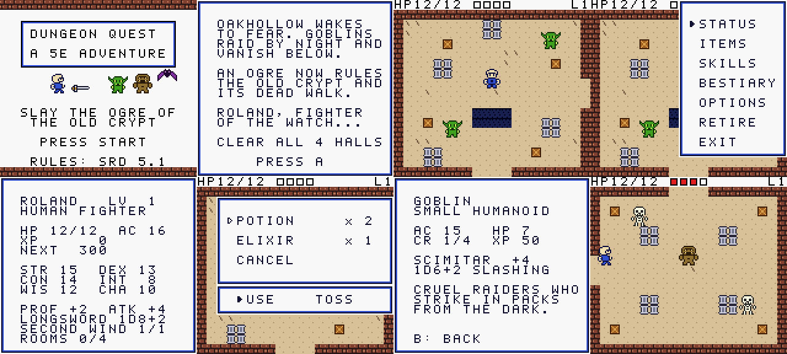

# Dungeon Quest: a Game Boy action RPG with D&D 5e rules

A top-down action RPG written in SM83 assembly for the Game Boy.
**Color-enhanced:** it plays in full color on a Game Boy Color, Game Boy Advance or GBA SP,
and falls back to 4-shade grayscale on an original Game Boy.



## Story
Goblins raid the village of Oakhollow by night and vanish below. An ogre now rules
the old crypt, and its dead walk. Roland, a fighter of the watch, must clear all four
halls and slay the ogre.

## Controls
| Button | In play | In menus |
|---|---|---|
| D-pad | Move | Move cursor / change option |
| A or B | Swing longsword | A = confirm, B = back |
| START | Open pause menu | Close menu |

## Features
- **Menus:** framed windows with a ▶ cursor and nested sub-menus. The pause menu has
  STATUS, ITEMS, SKILLS, BESTIARY, OPTIONS, RETIRE and EXIT.
  - STATUS: character sheet (level, HP, AC, XP, next level, STR/DEX/CON/INT/WIS/CHA, proficiency, weapon)
  - ITEMS: Potion of Healing (2d4+2) and Elixir (full heal), each with a USE / TOSS sub-menu and a message box
  - SKILLS: Second Wind (1d10 + level), which recharges when you clear a room (a short rest)
  - BESTIARY: a page for each monster you've met (stat block plus lore)
  - OPTIONS: palette (COLOR / GREEN / GRAY) and sound on/off
- **5e combat:** each sword hit is a d20 + 4 attack roll against the monster's AC.
  A natural 1 always misses; a natural 20 is a critical that doubles the damage dice.
  The longsword does 1d8+2. Monsters roll against your AC 16 too, and a miss shows "BLOCK".
- **Progression:** XP thresholds of 300 / 900 / 2700 / 6500. Each level adds the
  fighter's hit die (d10) + CON to max HP.
- **Monsters (SRD stats):** Goblin, Giant Bat, Skeleton, and the boss, an Ogre (CR 2).
- **Extras:** 4 connected rooms, simple monster AI, knockback, hearts that monsters drop
  (a heart picked up at full HP becomes a potion), sound effects.

## Build
```
make            # needs RGBDS 0.9+ and Python 3
```
Play `dungeon_quest.gb` in mGBA, SameBoy, BGB or Emulicious, or on a flash cart.

## Files
- `game.asm`: the engine (rendering, menus, window streaming, combat, AI, rooms, sound)
- `gen_gfx.py`: ASCII pixel art, font, menu frames and GBC palettes; it generates `gfx.inc`
- `gfx.inc`: the generated tile data and text charmap

## How the menus work
Each menu is composed in a 20x18 buffer in RAM and copied to the Game Boy's window layer
during VBlank, 3 rows per frame. A LY=LYC interrupt turns the window off below the box,
so menus can float over the dungeon. On the Color models, each tile type gets its own
palette from the VRAM bank 1 attribute map.

## Legal
This work includes material taken from the System Reference Document 5.1 ("SRD 5.1")
by Wizards of the Coast LLC and available at
https://dnd.wizards.com/resources/systems-reference-document. The SRD 5.1 is licensed
under the Creative Commons Attribution 4.0 International License available at
https://creativecommons.org/licenses/by/4.0/legalcode.

The story, characters, lore text, pixel art and code are original. This project isn't
affiliated with or endorsed by Wizards of the Coast or Nintendo.
